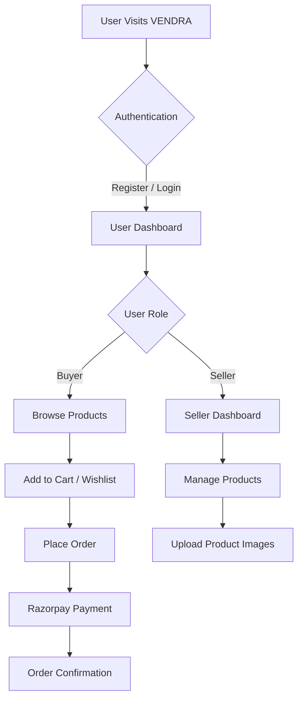

## 🎥 Demo Video

Watch the complete VENDRA walkthrough, showcasing its buyer and seller workflows, product management, cart functionality, and other key features.

https://github.com/user-attachments/assets/9813453a-9802-4ac0-8b89-76cd7487a6ec

# VENDRA — Multi-Vendor E-Commerce Platform

A full-stack multi-vendor e-commerce platform built with the MERN stack, designed to provide a seamless shopping experience for buyers and powerful product management capabilities for sellers.

## 🌐 Live Demo

- **Frontend:** https://vendra-woad.vercel.app
- **Backend API:** https://vendra-kxjb.onrender.com
- **GitHub Repository:** [VENDRA](https://github.com/RishiMaheshwari-25/VENDRA)

> Replace the frontend URL above with your actual Vercel deployment URL if it is different.

## 📌 About the Project

VENDRA is a multi-vendor e-commerce application where buyers can explore products, manage their shopping carts and wishlists, and place orders. Sellers can manage their own products and access seller-specific functionality through role-based authorization.

The project focuses on building a scalable backend architecture, secure authentication, RESTful APIs, and a responsive frontend experience.

## ✨ Features

### 👤 Authentication & Authorization
- User registration and login
- JWT-based authentication
- Google authentication integration
- Role-based access control for buyers and sellers
- Protected routes and APIs
- Secure logout with Redis token blacklisting

### 🛍️ Product Management
- Seller-specific product management
- Create, update, and delete products
- Product image uploads using ImageKit
- Support for multiple product variants
- Variant-specific attributes and details
- Product listing and browsing

### 🛒 Shopping Experience
- Add products to cart
- Manage cart items
- Add and remove wishlist products
- Product variant selection
- Order placement workflow

### 💳 Payments
- Razorpay payment gateway integration
- Payment order creation
- Payment verification

### 🔐 Backend & Security
- RESTful API architecture
- Middleware-based authentication
- Role-based route protection
- MongoDB database integration
- Redis-based token blacklisting
- Input validation and error handling

## 🧰 Tech Stack

| Category | Technologies |
|---|---|
| Frontend | React.js, JavaScript, SCSS |
| State Management | Redux Toolkit |
| Routing | React Router |
| Backend | Node.js, Express.js |
| Database | MongoDB, Mongoose |
| Authentication | JWT, Google OAuth |
| Caching / Token Management | Redis |
| Image Storage | ImageKit |
| Payments | Razorpay |
| Deployment | Vercel, Render |
| Version Control | Git, GitHub |

## 📁 Project Structure

```text
VENDRA/
│
├── Backend/
│   ├── src/
│   │   ├── config/
│   │   ├── controllers/
│   │   ├── middlewares/
│   │   ├── models/
│   │   ├── routes/
│   │   └── utils/
│   │
│   ├── server.js
│   ├── package.json
│   └── .env
│
├── Frontend/
│   ├── public/
│   ├── src/
│   │   ├── components/
│   │   ├── pages/
│   │   ├── hooks/
│   │   ├── redux/
│   │   └── assets/
│   │
│   ├── package.json
│   └── .env
│
└── README.md
```

*Folder names are illustrative; adjust them to match the actual repository structure.*

## ⚙️ Getting Started

Follow these steps to run VENDRA locally.

### 1. Clone the Repository

```bash
git clone https://github.com/RishiMaheshwari-25/VENDRA.git
```

```bash
cd VENDRA
```

### 2. Backend Setup

```bash
cd Backend
npm install
```

Create a `.env` file inside the `Backend` directory and configure the required environment variables:

```env
PORT=5000
MONGO_URI=your_mongodb_connection_string
JWT_SECRET=your_jwt_secret

REDIS_URL=your_redis_connection_url

CLIENT_URL=http://localhost:5173

IMAGEKIT_PUBLIC_KEY=your_imagekit_public_key
IMAGEKIT_PRIVATE_KEY=your_imagekit_private_key
IMAGEKIT_URL_ENDPOINT=your_imagekit_url_endpoint

RAZORPAY_KEY_ID=your_razorpay_key_id
RAZORPAY_KEY_SECRET=your_razorpay_key_secret
```

Install dependencies and start the backend:

```bash
npm run dev
```

### 3. Frontend Setup

Open a new terminal:

```bash
cd Frontend
npm install
```

Create a `.env` file inside the `Frontend` directory:

```env
VITE_API_URL=http://localhost:5000
```

Start the frontend development server:

```bash
npm run dev
```

The application should now be available at the local development URL displayed in your terminal.

## 🔄 Application Workflow



## 🚀 Deployment

VENDRA uses separate deployment platforms for its frontend and backend.

- **Frontend:** Deployed on Vercel
- **Backend:** Deployed on Render
-
